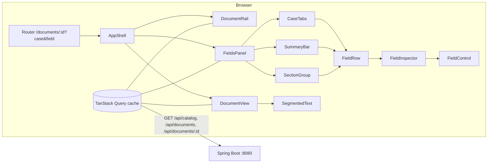

# Case Intake — Review UI (Frontend design and plan)

Status: agreed in the frontend grilling round (2026-11-07). Answers Q1–Q11 were all taken as recommended.
Companion docs: [HLD.md](HLD.md), [LLD.md](LLD.md) §12 (REST API), [PLAN.md](PLAN.md) (backend).

## 1. Decisions

| # | Decision |
|---|---|
| Q1 | Vite + React 19 + TypeScript (strict). Vitest + Testing Library + MSW. `npm test` runs offline from committed fixtures. `npx tsc --noEmit` must pass. |
| Q2 | Hand-rolled CSS with design tokens (CSS variables, light and dark). **Radix primitives** only for the accessible hard parts: Select, Popover (multi-select), Tabs, Tooltip. |
| Q3 | TanStack Query for data. React Router keeps the selection in the URL: `/documents/:id?case=<i>&field=<fieldId>`. |
| Q4 | Three panes: **document rail** (id, title, case count, flags, risk count), **document text** (centre), **fields panel** (right, case tabs on top). Below 960px the fields panel becomes a bottom sheet. |
| Q5 | **Compact row + inspector.** A row shows label, value, status and confidence. Selecting a row expands an inspector with the catalog-driven control, all quotes, and the note or conflict candidates. Edits are a local draft marked "edited" with a reset button; persistence arrives with the PATCH stretch item. |
| Q6 | The text is split into segments at every provenance boundary of the current case. Every quote gets a faint dotted underline. The selected field's spans are strongly highlighted, and the view scrolls to the first one with `scrollIntoView()`. Code-point offsets are converted to UTF-16 once per document. |
| Q7 | Icon + colour + text label for every state, never colour alone. A summary bar shows a count per state; clicking a chip filters the list. "Risky only" shows conflict plus the two lower confidence levels. `unknown` has its own filter. |
| Q8 | Skeleton loading. Inline error panel with the problem+json message and a retry button. No-case documents get an explanatory panel driven by the flags. |
| Q9 | Now: `j`/`k` and ↓/↑ move between fields, `Esc` clears the selection, clicking a quote selects its field. Later, with PATCH: `a` accept, `r` reject. |
| Q10 | Calm clinical theme with light and dark modes. Inter for the UI, Source Serif 4 for the document text, one accent colour. |
| Q11 | `frontend/` folder. `./start.sh` runs the backend jar (server mode) and `vite dev` on :5173, with `/api` proxied to :8080. |

## 2. UI design prompt (recorded verbatim for NOTES.md)

This is the exact prompt given to the AI (Claude Code, Opus 5.5) to design the screen. Revise it only by adding a dated "Revision" line below it; never edit it in place.

> Design a desktop-first review screen for a pharmacovigilance case reviewer, built in React 19 + TypeScript with hand-written CSS (design tokens as CSS variables, light and dark themes) and Radix primitives for Select, Popover, Tabs and Tooltip.
>
> **The job:** a reviewer checks values a language model extracted from an adverse-drug-reaction report. They must find the risky values fast, verify each against the exact quote in the source text, and never trust a value they cannot trace. A wrong value is worse than an empty one.
>
> **Layout:** three panes.
> 1. A narrow left rail lists documents: id, title (one line, truncated), number of cases, flag icons (no case, multiple patients, unsupported format, embedded instructions ignored) and a small risk count.
> 2. The centre shows the document text as a readable document, not code: Source Serif 4, 17px, line-height 1.65, max 72ch, whitespace preserved. Every quote that backs a field gets a faint dotted underline. The selected field's quotes get a solid highlight in the accent tint, and the view scrolls to the first one.
> 3. The right panel has case tabs when there is more than one case, then a summary bar, then fields grouped by catalog section in catalog order.
>
> **Summary bar:** one chip per state, each with a count: high, medium, low, unknown, conflict, edited. Clicking a chip filters the list. A "Risky only" toggle shows conflict plus medium and low.
>
> **Field rows:** compact (36px). Show label, value (formatted by type), and a status/confidence badge. Badges always combine icon + colour + text:
> - high: ✓, green
> - medium: ◐, amber
> - low: !, orange-red
> - unknown: ?, neutral grey with a dashed outline; the value reads "Not stated"
> - conflict: ⇄, violet; the value reads "Conflict" and the candidates are shown
> - edited: ✎, blue
>
> **Inspector:** clicking a row expands it inline. It shows:
> - the editable control for the field type: text input; number input with min/max; native date input; single Select for coded fields; checkbox-list Popover for coded_multi with chips; tag input for string_list
> - each quote as a clickable excerpt that scrolls the text
> - the model's note
> - "Reset to model value" when edited
>
> **States:** skeleton loaders shaped like the final layout. An inline error card with a retry button and the server's message. A deliberate no-case panel that explains why, from the flags ("No adverse event reported", "Image-only PDF — not processed", "Minimum case elements missing") and does not look broken.
>
> **Craft:**
> - 4px spacing grid; type scale 12/13/14/16/20/24
> - neutral greys plus one teal accent; status colours tuned for WCAG AA on both themes
> - focus rings always visible
> - motion 120–180ms ease-out, disabled under prefers-reduced-motion
> - keyboard: j/k or arrows move between fields, Esc clears the selection
>
> No field names may be hard-coded: sections, labels, order, option labels and controls all come from the catalog JSON.

## 3. Architecture



- **State:** the server state lives in TanStack Query (keys `['catalog']`, `['documents']`, `['document', id]`). The selection (document, case, field) lives in the URL. Drafts are a `useReducer` keyed by `docId/caseIndex/fieldId`, held in memory for the session.
- **Selection flow:** a row click or a quote click sets `?field=`. `DocumentView` reads `field` and highlights those spans. A `useLayoutEffect` calls `firstSpanRef.scrollIntoView({block: 'center', behavior})`, with `behavior` set to `auto` under reduced motion.

## 4. Low-level design

### 4.1 Files

```
frontend/
  index.html  vite.config.ts  tsconfig.json  package.json  vitest.setup.ts
  src/
    main.tsx  App.tsx  routes.tsx
    api/types.ts  api/client.ts  api/queries.ts
    lib/offsets.ts  lib/segments.ts  lib/format.ts  lib/risk.ts  lib/drafts.ts
    components/AppShell.tsx  DocumentRail.tsx  DocumentView.tsx  SegmentedText.tsx
    components/FieldsPanel.tsx  CaseTabs.tsx  SummaryBar.tsx  SectionGroup.tsx  FieldRow.tsx
    components/FieldInspector.tsx  StatusBadge.tsx  states/{Skeletons,ErrorCard,NoCasePanel}.tsx
    components/controls/{FieldControl,TextControl,NumberControl,DateControl,CodedSelect,CodedMultiSelect,StringListControl}.tsx
    hooks/useFieldKeyboard.ts  hooks/useSelection.ts
    styles/tokens.css  styles/base.css  (+ one .module.css per component)
  test/msw/handlers.ts  test/fixtures.ts  test/*.test.tsx
start.sh   (repo root)
```

### 4.2 Types (`api/types.ts`)

These mirror the catalog file and the API. No field ids appear anywhere in the source.

```ts
type FieldType = 'string'|'integer'|'number'|'date'|'coded'|'coded_multi'|'string_list';
interface CatalogField { id: string; label: string; section: string; type: FieldType;
  options?: {code: string; label: string}[]; validation?: {pattern?: string; min?: number; max?: number}; guidance?: string }
interface Catalog { catalog_version: string; confidence_levels: string[]; sections: {id: string; label: string}[];
  fields: CatalogField[]; statuses: Record<string,string> }
type Status = 'extracted'|'unknown'|'conflict';
interface Provenance { quote: string; start: number; end: number }
interface FieldResult { status: Status; value?: unknown; confidence?: string; provenance?: Provenance[]; note?: string }
interface CaseOutput { case_index: number; label?: string; fields: Record<string, FieldResult> }
interface Extraction { document_id: string; catalog_version: string; model?: string; flags?: string[]; cases: CaseOutput[] }
interface DocumentSummary { id: string; title: string; caseCount: number; flags: string[]; reviewCounts: ReviewCounts }
interface ReviewCounts { conflict: number; unknown: number; byConfidence: Record<string, number> }
interface DocumentDetail { id: string; title: string; text: string | null; extraction: Extraction }
```

A `FieldType` outside the union makes `FieldControl` render an explicit "Unsupported field type" notice. The switch is exhaustive, so TypeScript flags a missing case. There is no silent fallback.

**API addition (backend Task 14):** `DocumentSummary.reviewCounts` is computed by the server from `out/`, summed over all cases. `byConfidence` is keyed by the catalog's confidence levels. LLD §12 is updated to match.

### 4.3 Offsets (`lib/offsets.ts`)

The backend's offsets count Unicode code points. JavaScript strings index UTF-16 code units.

```ts
buildCodePointIndex(text: string): Uint32Array   // utf16Offset[cp], length = codePointCount + 1
toUtf16(index: Uint32Array, cp: number): number   // throws RangeError when cp > codePointCount
```

`DocumentView` builds the index once per document (`useMemo`). If a span has `end > codePointCount` or `start >= end`, it is skipped, a ⚠ "Quote position outside document" marker appears in the inspector, and `console.error` is called. This is never silent.

### 4.4 Segments (`lib/segments.ts`)

```ts
interface Segment { from: number; to: number; fieldIds: string[] }   // UTF-16 offsets
buildSegments(textLength: number, spans: {fieldId: string; from: number; to: number}[]): Segment[]
```

- Boundaries: `{0, textLength} ∪ every from/to`, sorted and deduplicated.
- Each segment lists the fields whose spans cover it entirely. Overlapping spans therefore just produce segments with several fields.
- `SegmentedText` renders segments with no fields as plain text, and the rest as `<span className="quote" data-fields="…">`.
- A segment that belongs to the selected field gets the `is-selected` class. The first such segment gets the scroll ref.
- Clicking a quote selects its field: the first of its fields, or the next one in catalog order if the same segment is clicked again.

### 4.5 Field presentation

| Catalog type | Row value | Inspector control |
|---|---|---|
| string | text | `TextControl` (`pattern` from catalog, inline validity message) |
| integer | number | `NumberControl` (step 1, min/max from catalog) |
| number | number | `NumberControl` (step any, min/max from catalog) |
| date | `D MMM YYYY` display, ISO in title | `DateControl` (`<input type="date">`) |
| coded | option **label** | `CodedSelect` (Radix Select, options from catalog) |
| coded_multi | option labels as chips | `CodedMultiSelect` (Radix Popover + checkbox list + chips) |
| string_list | chips; an empty list shows "None stated" | `StringListControl` (chips + add/remove) |

- **Badges (`StatusBadge`):** the confidence visual is chosen by **rank** in `catalog.confidence_levels` (0 = strongest), not by name. The text shown is the catalog's own level name.
  - rank 0 gets `--ok`
  - the middle ranks get `--caution`
  - the last rank gets `--risk`
  - `unknown` gets `--muted` with a dashed outline
  - `conflict` gets `--conflict`
  - an edited draft gets `--edited`
- **Risk (`lib/risk.ts`):** `isRisky(result, levels)` is true for conflict, or for extracted values whose rank is greater than 0.
- **A catalog field missing from the case output** renders as unknown with the note "Not in this output". This happens with an older output read under a newer catalog.

### 4.6 Keyboard (`useFieldKeyboard`)

- `j`/↓ selects the next visible field and `k`/↑ the previous one, both in catalog order after filters.
- `Enter` toggles the inspector. `Esc` clears the selection.
- Shortcuts are ignored while focus is in an input, select or contenteditable element.

### 4.7 States

- Rail and panes show skeletons while their query is pending.
- `ErrorCard` shows the problem+json `detail` (or the HTTP status text) and a Retry button that calls `refetch`.
- When `cases` is empty, `NoCasePanel` maps the flags to messages:
  - `no_adverse_event`: "No adverse event reported"
  - `missing_minimum_elements`: "Minimum case elements missing"
  - `unsupported_format`: "Image-only PDF — not processed"
  - any other flag: shown as-is in a neutral chip
- A null `text` makes the document pane show "No text layer" instead of an empty pane.

## 5. Implementation plan

> **For agentic workers:** REQUIRED SUB-SKILL: Use superpowers:subagent-driven-development (recommended) or superpowers:executing-plans to implement this plan task-by-task. Steps use checkbox (`- [ ]`) syntax for tracking.

**Goal:** A catalog-driven React 19 review screen that shows each document beside its extracted fields, highlights and scrolls to each value's quote, and makes risky values obvious.

**Architecture:** Vite SPA in `frontend/`. Server data comes through TanStack Query from `/api/*`, and the selection lives in the URL. Pure libraries (`offsets`, `segments`, `risk`) carry the logic and are unit-tested. Components render from the catalog only.

**Tech Stack:** React 19, TypeScript 5 (strict), Vite, React Router, TanStack Query, Radix (Select, Popover, Tabs, Tooltip), Vitest, Testing Library, MSW, jsdom.

**Spec:** this document §1–§4. The API is in LLD §12, plus `reviewCounts` (§4.2).

### Global Constraints

- "Field order, labels, sections and controls come from the catalog. A `coded` field shows its options, a `date` field a date control, a `coded_multi` field a multi-select. No field id appears in the UI source."
- "Select a field, and its quote highlights in the document and scrolls into view." The highlight is a `<span>` built from the API's start/end, converted from code points to UTF-16, and scrolled with `scrollIntoView()`.
- "Confidence and status are visible at a glance. `unknown` and `conflict` have their own presentation." Every state uses icon + colour + text.
- "Loading, empty and error states exist. A document with no cases looks intentional."
- "`npx tsc --noEmit` must pass." `npm test` passes offline.
- "The UI talks to the backend only through this API."
- The design prompt in §2 is recorded verbatim in NOTES.md.

### Review Focus

1. **An emoji or other astral character before a quote.** Without conversion the highlight would be shifted. Test: F2 `offsetsHandleAstralCharacters`.
2. **Two fields whose quotes overlap.** Both should stay clickable, and selecting one should highlight exactly its range. Test: F2 `overlappingSpansSplitIntoSegments`.
3. **A document with `text: null` (S03).** No crash; the "No text layer" panel and the flags are shown. Test: F4 `nullTextShowsNoTextLayer`.
4. **A provenance span beyond the text length (corrupt output).** It should render with no highlight and a visible warning, not crash. Test: F5 `outOfRangeSpanShowsWarning`.
5. **A catalog field missing from a case's fields (newer catalog).** The row should show as unknown with "Not in this output". Test: F6 `catalogFieldAbsentFromOutputRendersUnknown`.

---

### Task F1: Scaffold, tokens, start script, catalog-only guard

**Files:**
- Create: `frontend/{package.json, vite.config.ts, tsconfig.json, index.html, vitest.setup.ts}`, `frontend/src/{main.tsx, App.tsx}`, `frontend/src/styles/{tokens.css, base.css}`, `start.sh`
- Test: `frontend/test/noFieldIds.test.ts`

**Interfaces:**
- Produces: the npm scripts `dev`, `build`, `test` (`vitest run`), `typecheck` (`tsc --noEmit`). The Vite proxy sends `/api` to `http://localhost:8080`.

- [ ] **Step 1: Failing test** `noFieldIdsInSource`. It reads `../catalog/field_catalog.json`, walks `src/**/*.{ts,tsx,css}`, and asserts that no file contains any field id as a whole word (in quotes or as an identifier).
- [ ] **Step 2:** Run `npm --prefix frontend test`. Expect FAIL, because the project doesn't exist yet.
- [ ] **Step 3:** Scaffold with `npm create vite@latest frontend -- --template react-ts`. Pin React 19 and add the dependencies from the Tech Stack. Write `tokens.css` with:
  - colour tokens `--bg --surface --text --muted --accent --ok --caution --risk --conflict --edited` for light and dark (`prefers-color-scheme`, plus `[data-theme]`)
  - spacing `--s1…--s8` on a 4px grid
  - type scale `--t12…--t24`
  - fonts Inter and Source Serif 4 from Google Fonts
  - motion `--ease`, `--dur-fast: 120ms`, `--dur: 180ms`

  Write `start.sh`: build the jar if it's missing, start `java -jar target/case-intake.jar` in the background, run `npm --prefix frontend run dev`, and `trap` stops both.
- [ ] **Step 4:** Run `npm --prefix frontend test && npm --prefix frontend run typecheck`. Expect PASS.
- [ ] **Step 5:** Commit: `feat(ui): scaffold React 19 app with tokens and start script`.

### Task F2: Pure libraries: offsets, segments, risk, format

**Files:**
- Create: `frontend/src/lib/{offsets.ts, segments.ts, risk.ts, format.ts}`
- Test: `frontend/test/{offsets,segments,risk,format}.test.ts`

**Interfaces:**
- Produces: `buildCodePointIndex`, `toUtf16` (§4.3); `buildSegments` (§4.4); `isRisky(result, levels)`, `confidenceRank(level, levels)`; `formatValue(field, value)` (§4.5 row column).

- [ ] **Step 1: Failing tests:**
  - `offsetsHandleAstralCharacters`: for the text `"😀 rash here"`, the quote "rash" is at code points 2–6, and `toUtf16` gives 3–7.
  - `offsetBeyondTextThrowsRangeError`
  - `overlappingSpansSplitIntoSegments`: spans A[2,8) and B[5,10) give segments [0,2)∅, [2,5)A, [5,8)AB, [8,10)B, [10,len)∅.
  - `riskUsesCatalogRankNotNames`: with levels `['x','y','z']`, x is not risky and y and z are.
  - `formatsCodedAsOptionLabel`
  - `emptyStringListIsNoneStated`
- [ ] **Step 2:** Run `npm --prefix frontend test`. Expect FAIL.
- [ ] **Step 3:** Implement per §4.3–§4.5.
- [ ] **Step 4:** Run the same command. Expect PASS. Then run `npm --prefix frontend run typecheck`.
- [ ] **Step 5:** Commit: `feat(ui): offset conversion, segmentation and risk helpers`.

### Task F3: API client, queries, MSW fixtures

**Files:**
- Create: `frontend/src/api/{types.ts, client.ts, queries.ts}`, `frontend/test/msw/handlers.ts`, `frontend/test/fixtures.ts`
- Test: `frontend/test/api.test.ts`

**Interfaces:**
- Produces: the §4.2 types; `getJson<T>(path)`, which throws `ApiError{status, detail}` built from problem+json; `useCatalog()`, `useDocuments()`, `useDocument(id)`.
- Fixtures: built from `catalog/field_catalog.json`, `schema/EXAMPLE-output-D01.json` + `documents/D01.txt`, plus one synthetic no-case document and one `text: null` document. They switch to the real `out/` files once backend Task 13 lands.

- [ ] **Step 1: Failing tests:**
  - `problemJsonDetailBecomesApiError`
  - `useDocumentReturnsTextAndExtraction`
  - `networkErrorSurfacesAsError`
- [ ] **Step 2:** Run `npm --prefix frontend test`. Expect FAIL.
- [ ] **Step 3:** Implement. Set up QueryClient defaults: `retry: 1` and `staleTime: Infinity`, since the data is committed files.
- [ ] **Step 4:** Run `npm --prefix frontend test`. Expect PASS.
- [ ] **Step 5:** Commit: `feat(ui): typed API client and queries with MSW fixtures`.

### Task F4: App shell, routing, rail, states

**Files:**
- Create: `frontend/src/routes.tsx`, `components/{AppShell, DocumentRail}.tsx`, `components/states/{Skeletons, ErrorCard, NoCasePanel}.tsx`, `hooks/useSelection.ts`
- Test: `frontend/test/shell.test.tsx`

**Interfaces:**
- Produces: `useSelection() → {docId, caseIndex, fieldId, select(fieldId|null), setCase(i)}`, backed by the URL.

- [ ] **Step 1: Failing tests:**
  - `railListsDocumentsWithCaseCountFlagsAndRisk`
  - `loadingShowsSkeletons`
  - `errorShowsMessageAndRetryRefetches`
  - `noCaseDocumentShowsReasonFromFlags`
  - `nullTextShowsNoTextLayer`
  - `firstDocumentSelectedByDefault`
- [ ] **Step 2:** Run `npm --prefix frontend test -- shell`. Expect FAIL.
- [ ] **Step 3:** Implement. The three-pane grid is `grid-template-columns: 280px minmax(0,1fr) 440px`, collapsing below 960px.
- [ ] **Step 4:** Run `npm --prefix frontend test`. Expect PASS.
- [ ] **Step 5:** Commit: `feat(ui): app shell, document rail and states`.

### Task F5: Document view with highlight and scroll

**Files:**
- Create: `components/{DocumentView, SegmentedText}.tsx` + CSS module
- Test: `frontend/test/documentView.test.tsx`

**Interfaces:**
- Consumes: `buildCodePointIndex`, `buildSegments`, `useSelection`.

- [ ] **Step 1: Failing tests:**
  - `selectingFieldHighlightsExactQuoteText`: on D01 with the field from `EXAMPLE` provenance (276, 284), the `.is-selected` text is exactly "Mrs M.K.". Look the field up by catalog position, not by id.
  - `selectingFieldCallsScrollIntoView`: mock `Element.prototype.scrollIntoView` and check it is called once with `{block:'center'}`.
  - `allQuotesGetFaintUnderline`
  - `clickingQuoteSelectsItsField`
  - `outOfRangeSpanShowsWarning`
- [ ] **Step 2:** Run `npm --prefix frontend test -- documentView`. Expect FAIL.
- [ ] **Step 3:** Implement per §3 and §4.4. Use `white-space: pre-wrap` and Source Serif 4. Scroll in a `useLayoutEffect` when `fieldId` changes, using `behavior: 'smooth'` unless reduced motion is set.
- [ ] **Step 4:** Run `npm --prefix frontend test`. Expect PASS.
- [ ] **Step 5:** Commit: `feat(ui): segmented document text with highlight and scroll`.

### Task F6: Fields panel: cases, sections, rows, badges, summary filters

**Files:**
- Create: `components/{FieldsPanel, CaseTabs, SummaryBar, SectionGroup, FieldRow, StatusBadge}.tsx` + CSS modules
- Test: `frontend/test/fieldsPanel.test.tsx`

- [ ] **Step 1: Failing tests:**
  - `sectionsAndFieldsFollowCatalogOrder`
  - `addedCatalogFieldRendersWithoutCodeChange`: the fixture catalog gains `zz_new` and its label appears.
  - `catalogFieldAbsentFromOutputRendersUnknown`
  - `caseTabsSwitchCases` (a two-case fixture)
  - `badgesCombineIconColourAndText`: each state has a distinct icon character and an accessible name.
  - `riskyOnlyShowsConflictAndLowerConfidence`
  - `summaryChipFiltersList`
- [ ] **Step 2:** Run `npm --prefix frontend test -- fieldsPanel`. Expect FAIL.
- [ ] **Step 3:** Implement per §4.5. Use Radix Tabs for the cases and Radix Tooltip for the full note on a badge.
- [ ] **Step 4:** Run `npm --prefix frontend test`. Expect PASS.
- [ ] **Step 5:** Commit: `feat(ui): catalog-driven fields panel with status and confidence badges`.

### Task F7: Inspector and dynamic controls with local drafts

**Files:**
- Create: `components/FieldInspector.tsx`, `components/controls/*.tsx`, `lib/drafts.ts`
- Test: `frontend/test/controls.test.tsx`

**Interfaces:**
- Produces: `FieldControl({field, value, onChange})`, which switches exhaustively on `field.type`. `useDrafts() → {get(key), set(key, value), reset(key)}`.

- [ ] **Step 1: Failing tests:**
  - `dateFieldRendersDateInput`
  - `codedFieldRendersSelectWithCatalogOptionLabels`
  - `codedMultiRendersMultiSelect`
  - `integerHonoursCatalogMinMax`
  - `stringPatternShowsValidityMessage`
  - `stringListAddsAndRemovesItems`
  - `editMarksRowEditedAndResetRestores`
  - `conflictInspectorListsCandidates`
- [ ] **Step 2:** Run `npm --prefix frontend test -- controls`. Expect FAIL.
- [ ] **Step 3:** Implement per §4.5. Drafts are kept in memory only, and the inspector says so ("Edits are not saved yet").
- [ ] **Step 4:** Run `npm --prefix frontend test`. Expect PASS.
- [ ] **Step 5:** Commit: `feat(ui): field inspector with catalog-driven controls`.

### Task F8: Keyboard, polish, docs

**Files:**
- Create: `hooks/useFieldKeyboard.ts`; Modify: `README.md`, `NOTES.md` (paste the §2 design prompt verbatim)
- Test: `frontend/test/keyboard.test.tsx`

- [ ] **Step 1: Failing tests:**
  - `jAndKMoveSelectionInCatalogOrder`
  - `escClearsSelection`
  - `shortcutsIgnoredInsideInputs`
- [ ] **Step 2:** Run `npm --prefix frontend test -- keyboard`. Expect FAIL.
- [ ] **Step 3:** Implement per §4.6. Polish pass covers visible focus rings, reduced motion, a dark-mode check, and a 13px minimum text size.
- [ ] **Step 4:** Run `npm --prefix frontend test && npm --prefix frontend run typecheck && ./start.sh`. Smoke test: open http://localhost:5173, select a field, and check the quote is highlighted and scrolled into view.
- [ ] **Step 5:** Commit: `feat(ui): keyboard navigation and docs`.

**Dependencies on the backend:** F3–F8 run against MSW fixtures, so they don't wait for the backend. Live wiring and the `start.sh` smoke test need backend Task 14 (API with `reviewCounts`) and Task 13 (real `out/`).
