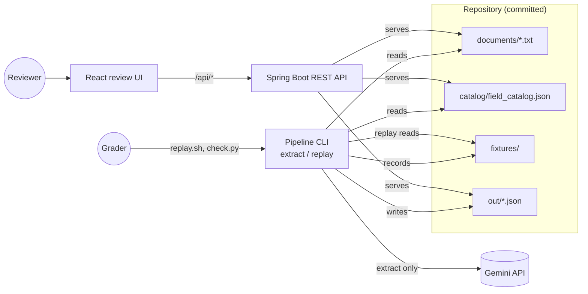
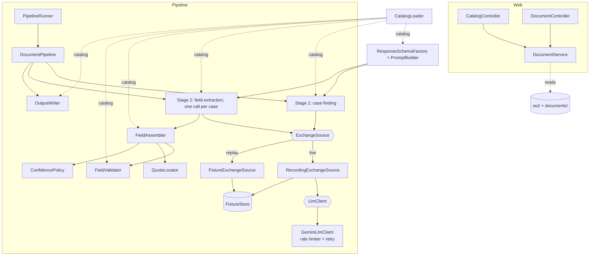
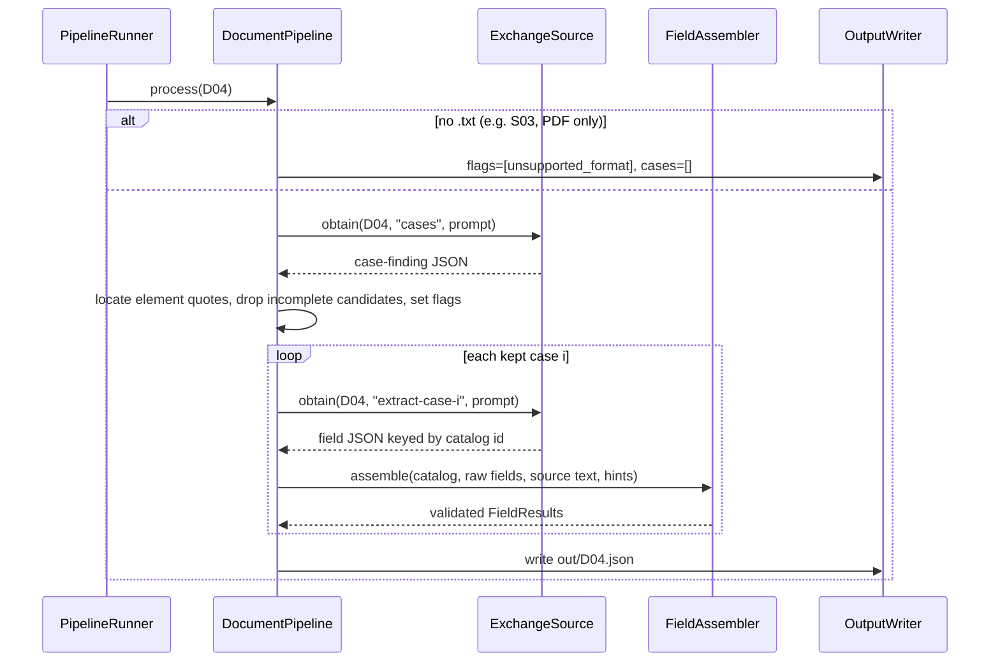
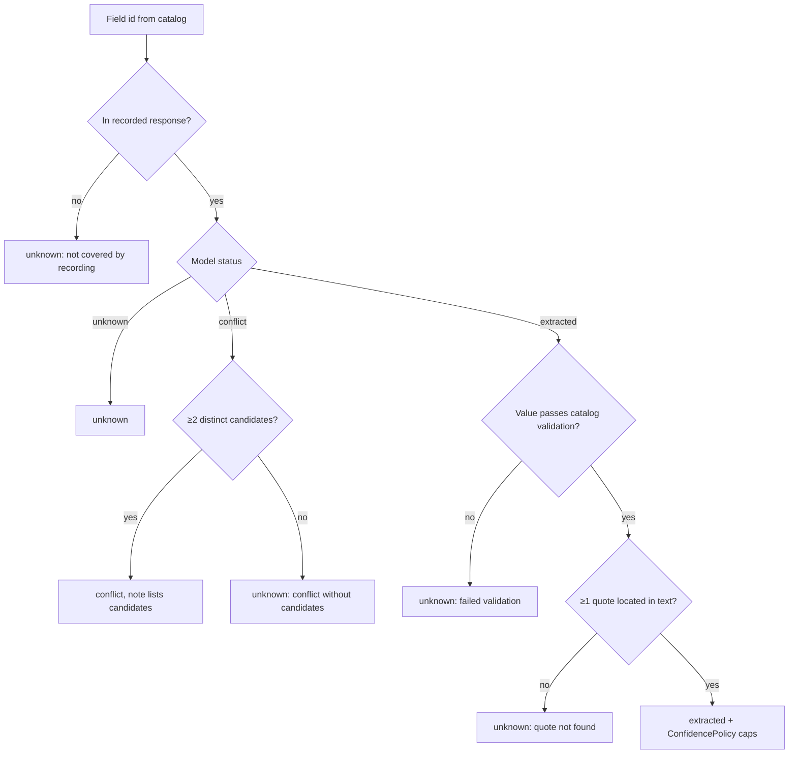

# Case Intake — High-Level Design

Status: agreed (grilling rounds 1–2, 2026-11-07). Frontend design is on hold until the backend ships.
Companion docs: [LLD.md](LLD.md) (component detail), [PLAN.md](PLAN.md) (task-by-task implementation).

## 1. Problem

Turn messy adverse-drug-reaction reports (`documents/*.txt`) into structured cases, one JSON file per document, following `catalog/field_catalog.json` and `schema/extraction.schema.json`. A human reviewer checks every value, so the system is built around three priorities, in this order:

1. **A wrong value is worse than an empty one.** Scoring: correct +1, unknown 0, wrong −2 / −1 / −0.5 at high / medium / low confidence. When in doubt the pipeline says `unknown` or `conflict`.
2. **Every value is traceable.** Each extracted value cites an exact span of the `.txt` file (Unicode code-point offsets).
3. **The catalog is the only definition of fields.** Adding a field or changing a rule in the catalog changes the prompt, the response schema, the validation and the UI, with no code change.

## 2. Scope

| In scope (core) | Stretch, in delivery order | Out of scope |
|---|---|---|
| Extraction pipeline (Java 21, Spring Boot 3), live and replay modes | 1. Stretch documents S01–S04 (S03 flagged `unsupported_format`) | Database |
| Fixtures + `replay.sh` | 2. Click quote → select field, keyboard navigation | Authentication |
| REST API: catalog, document list, document detail | 3. Review actions (PATCH accept / reject / edit) | Vision / OCR |
| React 19 review UI (design on hold) | 4. Duplicate detection (`out/duplicates.json`) | Deployment |

## 3. System context



One Spring Boot application, three entry modes:

| Mode | Command | Network | Key |
|---|---|---|---|
| `extract` | `java -jar target/case-intake.jar extract [--only=D04] [--force]` | yes | `GEMINI_API_KEY` |
| `replay` | `./replay.sh [catalog-path]` | no | no |
| server (default) | `./start.sh` (backend + UI) | no | no |

## 4. Architecture



### Key design decisions

| # | Decision | Why |
|---|---|---|
| D1 | **Two-stage extraction.** Stage 1 finds patients and checks the four minimum elements (patient, reporter, suspect drug, event), each backed by a quote. Stage 2 runs once per case and extracts every catalog field. | Multi-patient documents (D04 mother + infant) and no-case documents (D06) are where cases are won or lost: a missing or extra case costs −2, a wrong no-case decision −3. |
| D2 | **The model returns quotes, Java computes offsets.** Offsets are code points. A quote that cannot be found makes the field `unknown`. | Models cannot count characters. The checker compares `text[start:end]` with the quote. |
| D3 | **The model sets confidence; deterministic rules can only lower it.** Derived or relative values are capped at medium, ambiguous numeric dates at low, and a quote that does not contain the value lowers it one level. | Calibration is scored. Rules are explainable and testable. |
| D4 | **Validate against the catalog before writing.** A value that fails becomes `unknown` with a note. It is never coerced. | An invalid value scores as wrong at high confidence. |
| D5 | **The live run and replay share one code path.** A live run records the exchange to `fixtures/` first, then parses the recorded copy. | `replay.sh` reproduces `out/` by construction. |
| D6 | **Fixtures are keyed by document and stage, not by request hash.** | Under a changed catalog the prompt changes, but replay must still use the same recordings and re-validate against the new catalog. |
| D7 | **The response schema is generated from the catalog** as provider-neutral JSON Schema. The Gemini adapter translates it to Gemini's dialect. | A catalog change changes the schema automatically. A provider change touches only the adapter. |
| D8 | **`LlmClient` interface; provider chosen by `llm.provider`; key from `GEMINI_API_KEY`.** | Switching provider is a config change. No key in any file. |
| D9 | **Rate limiting:** a client-side requests-per-minute limiter, retry with backoff that honours the server's `retryDelay`, a hard stop when the daily quota is gone, and resumable runs. | Free tiers allow roughly 20–500 requests per day. |
| D10 | **Document text is data.** It goes in a fenced block with a random marker, and the system instruction says nothing inside is an instruction. Stage 1 reports embedded instructions, and these become a reviewer flag. | D07 contains an injection aimed at automated systems. |
| D11 | **Per-stage model config.** Flash-Lite for case finding, Flash for extraction. | Fits the free-tier daily quotas. |
| D12 | **Only values stated about this patient.** A drug that reached the patient through another person (in utero) leaves dose and route `unknown`. | A general rule, not a special case for D04. |

## 5. Data flow for one document



## 6. Field status decision



## 7. Interfaces

**REST** (the backend serves committed files, no database):

| Method | Path | Response |
|---|---|---|
| GET | `/api/catalog` | the catalog JSON |
| GET | `/api/documents` | `[{id, title, caseCount, flags}]` |
| GET | `/api/documents/{id}` | `{id, title, text, extraction}`. 404 as `application/problem+json` |
| PATCH (stretch) | `/api/documents/{id}/cases/{caseIndex}/fields/{fieldId}` | review action |

**Files:** `out/<ID>.json` (extraction schema), `fixtures/<ID>/<stage>.attempt-<n>.json`, later `out/duplicates.json`.

## 8. Cross-cutting concerns

- **Secrets.** `application.yml` holds `api-key: ${GEMINI_API_KEY:}` only. `.gitignore` covers `Gemini API Key/`, `.env` and `*.local.yml`. The redactor strips the key from every fixture and refuses to write if the key is still present. A test fails if any committable file contains a string that looks like a Google API key.
- **Determinism.** `out/` depends only on fixtures, documents and catalog. Fields are written in catalog order, and there are no timestamps in `out/`.
- **Failure policy.** No silent fallbacks. A document that fails after retries is reported and gets no output file. The run exits non-zero.
- **Testing.** Everything under `./mvnw test` runs offline, including a golden replay test (replay equals committed `out/`) and a catalog-generality test. `tools/check.py` runs through `scripts/score.sh`.

## 9. Repository layout

```
/                      pom.xml, mvnw, replay.sh, start.sh, README.md, NOTES.md, CLAUDE.md
src/main/java/com/caseintake/...   backend (see LLD §2)
src/main/resources/application.yml
src/test/java/...      offline tests
frontend/              React 19 + TS + Vite (on hold)
fixtures/  out/        committed artefacts
docs/solution/         HLD.md, LLD.md, PLAN.md
documents/ catalog/ schema/ answers/ tools/   provided, unchanged
```

## 10. Risks

| Risk | Mitigation |
|---|---|
| The free-tier daily quota is too small (reports say 20 per day for Flash) | Per-stage models, resumable runs, `--only` / `--stage` re-runs |
| Gemini rejects a schema with about 110 properties as too complex | Contingency: split stage 2 into one call per catalog section (sections come from the catalog, so still generic) |
| The model paraphrases quotes | Locator folds case, whitespace and typographic quotes/dashes. The prompt demands verbatim copies of at least 3 characters. Anything not found becomes `unknown`. |
| `coded_multi` "none must stand alone" is guidance text, not a validation key | Passed to the model through the catalog guidance. Not hard-coded (known limitation, noted in NOTES.md). |
